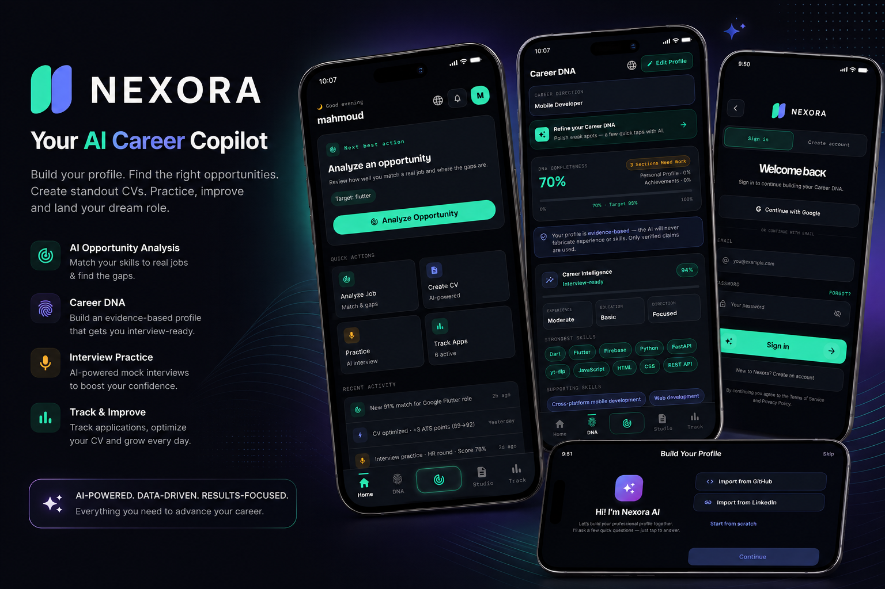

# Nexora — AI Career Intelligence Platform

**From "I don't know what to apply for" to a tailored CV and a scored mock interview — in one flow.**

Nexora is a cross-platform Flutter app backed by Supabase. It reads a user's real experience, builds a structured profile, scores how well they match a job, writes an ATS-friendly CV for that job, runs a voice mock interview, and tracks every application in one pipeline.

AI-generated text is never the source of truth for a score: matching and CV evaluation run in deterministic Dart engines, and the LLM is used for generation and coaching behind an authenticated server-side proxy.

<p>
  
  
  
  
  
  
</p>

> **Live web build:** https://mahmoudfahmy616572.github.io/nexora/



---

## Table of contents

- [The flow](#the-flow)
- [Features](#features)
- [How the AI is wired](#how-the-ai-is-wired)
- [Architecture](#architecture)
- [Data model](#data-model)
- [Testing](#testing)
- [Running locally](#running-locally)
- [Known limitations](#known-limitations)
- [License](#license)

---

## The flow

| Step | What happens | Where |
|---|---|---|
| 1. **Intake** | Upload a CV, connect GitHub, or answer guided AI questions. The model drafts profile sections; the user edits and approves. | `lib/presentation/career_intake/` |
| 2. **Career DNA** | Approved experience is normalized into a structured, versioned profile (`career_dna`, `career_dna_versions`). | `lib/features/main/presentation/` |
| 3. **Match analysis** | Paste a job description → deterministic match engine returns a breakdown (skills, seniority, domain, gaps), never a hallucinated percentage. | `lib/domain/analysis/opportunity_match_engine.dart` |
| 4. **CV Studio** | Generate a CV tailored to that specific job, pick a template, export PDF, keep version history, and get an evaluation score. | `lib/features/main/presentation/studio/` |
| 5. **Interview + tracker** | Voice mock interview with scored feedback, then track the application through the pipeline. | `interview_practice_screen.dart`, `tracker_screen.dart` |

---

## Features

**Profile & intake**
- Email/password, Google OAuth, and password reset via Supabase Auth (`sign_in_screen.dart`).
- Three intake paths: AI-guided interview, GitHub import, and manual editing.
- Versioned Career DNA with a "Smart Builder" for gaps.

**Matching & analysis**
- Deterministic opportunity-match engine with per-criterion scoring and human-readable reasoning.
- Analysis history so users can compare roles over time.

**CV Studio**
- Job-tailored generation with a factual fallback path (no invented employers).
- Validation pass before save, plus post-generation evaluation.
- Three PDF templates, document versioning, and native PDF export/share.

**Interview prep**
- Question banks per role/level.
- Voice practice with TTS + speech-to-text and scored feedback (structure, relevance, clarity).

**Product surface**
- Five-tab responsive shell (NavigationRail on wide layouts).
- Dark theme, custom typography, full **English + Arabic** with RTL-correct layouts and Arabic PDF support.
- Runs on Android, iOS, Web, Windows, macOS and Linux from one codebase.

---

## How the AI is wired

```
Flutter client
   │  (JWT from Supabase Auth)
   ▼
Supabase Edge Functions (Deno)          ← GROQ_API_KEY lives here only
   │  JSON mode · truncation repair · deterministic fallbacks
   ▼
Groq · openai/gpt-oss-120b

Flutter client
   └─► Deterministic Dart engines (no network): match score, CV evaluation
```

Eight edge functions, each doing one job:

| Function | Responsibility |
|---|---|
| `ai_intake` | Guided intake → draft profile sections |
| `build_profile` | Turn raw intake into structured DNA |
| `profile_draft` | Draft/repair profile copy |
| `ai_enhance` | Improve a specific section without inventing facts |
| `analyze` | Explain a deterministic match result in natural language |
| `cv_generate` | Tailored CV body for a target job |
| `cv_evaluate` | Score and criticize a generated CV |
| `career_interview` | Generate questions and score spoken answers |

Design rules that are enforced in code:

- **The model never owns a number.** Scores come from pure Dart (`opportunity_match_engine.dart`, `cv_evaluator.dart`), so the same input always yields the same score.
- **The API key never reaches the client.** All calls go through edge functions that validate the caller's JWT first.
- **Failures degrade, they don't crash.** Truncated JSON is repaired; on failure the client falls back to local storage and a factual template rather than showing an error wall.

---

## Architecture

```
lib/
├── core/                 # router (go_router + auth guard), theme, config, DI scope
├── data/                 # data sources + repositories (Supabase ⇄ local cache)
├── domain/               # pure logic: match engine, CV evaluator, models
├── features/
│   ├── auth/             # sign-in, reset
│   └── main/presentation # home, dna, studio, prep, analyze, tracker, targets
├── presentation/         # splash, onboarding, career intake, sign-in
└── l10n/                 # generated EN/AR localizations (gen-l10n)

supabase/
├── migrations/           # 11 SQL migrations (schema + RLS)
└── functions/            # 8 Deno edge functions
```

- **State:** `flutter_bloc` — Cubits scoped per feature.
- **Routing:** `go_router` with a single auth redirect guard.
- **DI:** explicit constructor composition through an app scope (no service locator).
- **Persistence:** Supabase Postgres with RLS, plus a SharedPreferences fallback layer for offline/degraded use.

---

## Data model

14 tables across 11 migrations, all protected by row-level security:

| Group | Tables |
|---|---|
| Identity | `profiles` |
| Career profile | `career_dna`, `career_dna_versions`, `profile_sections`, `profile_content`, `career_targets` |
| Documents | `cvs`, `cv_documents`, `cv_versions`, `cv_suggestions`, `cv_evaluations` |
| Analysis | `job_analyses` |
| Applications | `job_applications` |
| Practice | `interview_practice_sessions` |

Every table is scoped to `auth.uid()`; the client only ever uses a publishable key.

---

## Testing

**57 test files** covering the parts that actually break in production:

- Deterministic scoring engines (match + CV evaluation) — table-driven cases.
- PDF generation and **Arabic RTL** text layout.
- Repository/data-source behavior, including the local-fallback path.
- Widget tests for the main flows and responsive shell.

```bash
flutter test
```

---

## Running locally

```bash
git clone https://github.com/Mahmoudfahmy616572/nexora.git
cd nexora
flutter pub get
```

Create `.env` / `--dart-define` values for the Supabase URL and **publishable** key, then:

```bash
flutter run -d chrome      # web
flutter run -d android     # device/emulator
```

Backend setup:

```bash
# 1) schema + RLS
supabase db push

# 2) AI proxy secrets (server-side only)
supabase secrets set GROQ_API_KEY=...

# 3) functions
supabase functions deploy ai_intake build_profile profile_draft ai_enhance \
  analyze cv_generate cv_evaluate career_interview
```

---

## Known limitations

Listed on purpose — a README that hides these is a red flag.

- Three migrations (opportunity analysis + CV engine + evaluation tables) are written but **not yet applied**; those screens currently fall back to local storage.
- Career intake questions and the AI prompts are English-first; the Arabic UI is complete but intake copy is not.
- LinkedIn import is disabled (no approved API access).
- Web deploys are manual (`flutter build web` + push); no CI pipeline yet.

---

## License

© Mahmoud Fahmy. All rights reserved. Source is public for review and evaluation.
For commercial use, white-labelling, or licensing, contact **mahmoudfahmeyy@gmail.com**.

- Portfolio: https://mahmoudfahmy616572.github.io/My_protfolio/
- LinkedIn: https://linkedin.com/in/mahmoud-fahmy-129946322
- GitHub: https://github.com/Mahmoudfahmy616572
